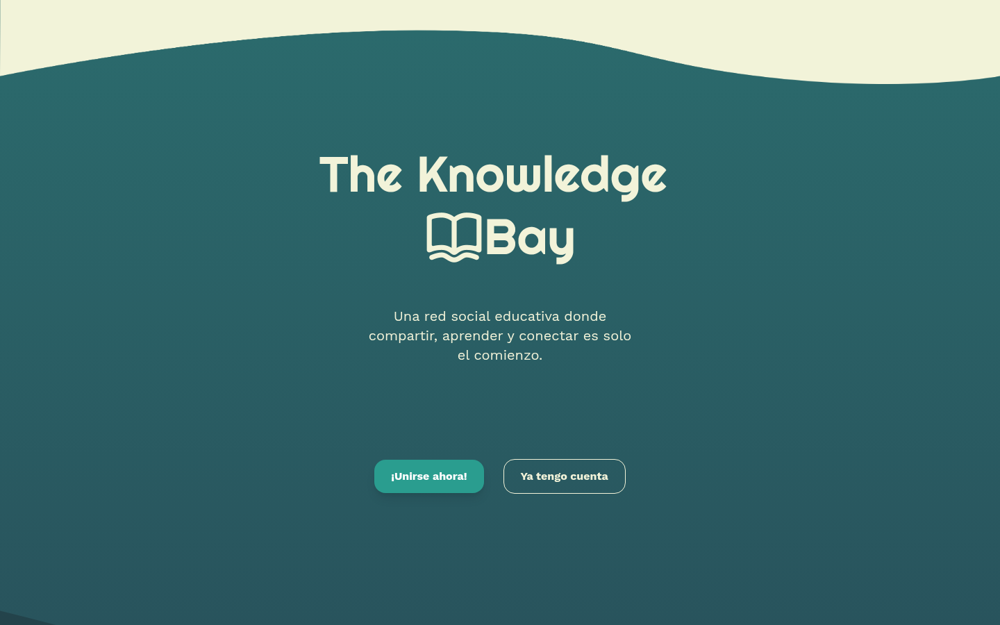
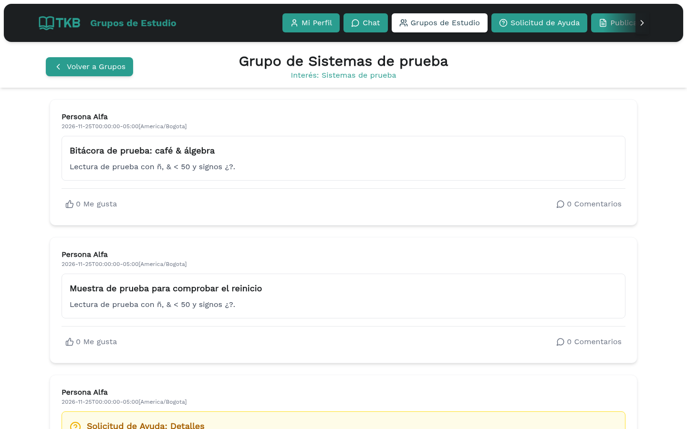
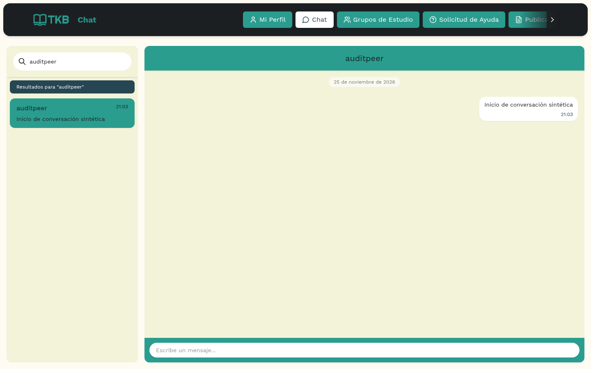
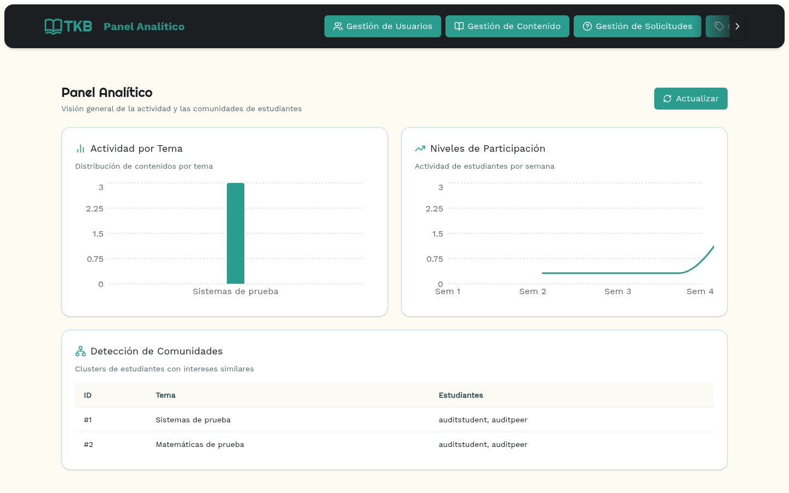
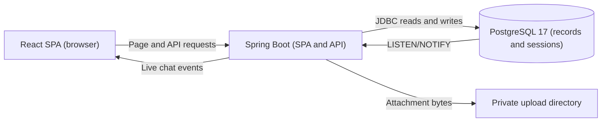

<!-- markdownlint-disable-next-line MD041 -->
<div align="center">

<h1>The Knowledge Bay</h1>

<p><strong>A learning network for students to share resources, ask for help, and study together.</strong></p>

<p>
<a href="https://github.com/diegnghtmr/the-knowledge-bay/actions/workflows/ci.yml"></a>


<a href="LICENSE.md"></a>
</p>

<p>
<a href="https://diegnghtmr.me/en/work/the-knowledge-bay/"><strong>Case study</strong></a> &bull;
<a href="#quick-start"><strong>Quick start</strong></a> &bull;
<a href="#architecture"><strong>Architecture</strong></a>
</p>

</div>

<p align="center"></p>

An explanation shared in a private conversation is hard for the next student to find. The Knowledge Bay gives students a Spanish-language space to publish what they know and find study groups formed around shared interests. Students can take a discussion into private chat, while moderators can see what the community is studying and where students are asking for help.

## Features

- **Share learning resources.** Publish articles, links, videos, and questions, or attach a PDF, PNG, or JPEG to a resource post for signed-in readers to download.
- **Find a study group.** Shared interests determine group membership, and group feeds show posts from the same records as the global feed.
- **Ask for help.** Publish a help request and discuss it in the relevant study group.
- **Connect with peers.** Follow other students, find them by name, username, or email, and start a private conversation even without an existing thread.
- **Chat without refreshing.** An open conversation receives new messages over an authenticated event stream, even when the participants connect to different instances, and can catch up from saved history if the stream is unavailable.
- **Moderate the network.** Manage users, content, interests, and help requests, and explore the student affinity graph and activity dashboards.
- **Stay signed in across restarts.** Sessions survive server restarts on the same PostgreSQL database until they expire or are revoked.

## Preview



*Study groups bring resources and help requests tagged with the same topic into one feed.*



*Students can find a peer and start a private conversation without an existing thread.*



*Moderators can review topic activity, participation, and communities based on shared interests. The screenshots use synthetic data.*

## Quick start

Use **Node.js 22**, **npm**, **JDK 21**, and an empty **PostgreSQL 17** database. The checked-in wrapper supplies Maven. For an existing installation, follow the [one-time SQLite copy instructions](docs/persistence.md#copy-an-existing-sqlite-database-once) instead of starting with an empty database.

```sh
git clone https://github.com/diegnghtmr/the-knowledge-bay.git
cd the-knowledge-bay
(cd client && npm ci)
(cd server && ./mvnw -B -DskipTests package)
```

Configure the server from the repository root. For all settings, see the [configuration reference](docs/configuration.md).

| Variable | Purpose | Default |
| --- | --- | --- |
| `MODERATOR_NAME`, `MODERATOR_EMAIL`, `MODERATOR_PASSWORD` | Moderator identity and private password. | Override all three for local use |
| `SPRING_DATASOURCE_URL`, `SPRING_DATASOURCE_USERNAME`, `SPRING_DATASOURCE_PASSWORD` | PostgreSQL connection for the application and Flyway. | Supply your database and credentials |
| `SERVER_ADDRESS`, `SERVER_PORT` | Bind to loopback on the port the Vite proxy uses. | Spring Boot bind address; port `8080` |

Export both passwords from a secret manager or enter them at these Bash prompts. The moderator password must be nonblank and at most 72 UTF-8 bytes. Do not commit them or supply them as command-line arguments.

```bash
read -r -s -p 'Moderator password: ' MODERATOR_PASSWORD
printf '\n'
read -r -s -p 'PostgreSQL password: ' SPRING_DATASOURCE_PASSWORD
printf '\n'
export MODERATOR_PASSWORD SPRING_DATASOURCE_PASSWORD
```

Then start the API in the same terminal:

```sh
export MODERATOR_NAME='Local Moderator'
export MODERATOR_EMAIL='moderator@example.invalid'
export SPRING_DATASOURCE_URL='jdbc:postgresql://127.0.0.1:5432/knowledge_bay'
export SPRING_DATASOURCE_USERNAME='knowledge_bay'
export SERVER_ADDRESS=127.0.0.1
export SERVER_PORT=8080
java -jar server/target/server-0.0.1-SNAPSHOT.jar
```

From the repository root in a second terminal, leave `VITE_API_BASE_URL` unset and start Vite:

```sh
cd client
npm run dev
```

Open `http://127.0.0.1:3000`. Vite proxies `/api` to the local server. Sign in as the configured moderator and add interests before registering students who want to join a group.

## Architecture

The [React client](client/) loads chat, profiles, and moderation routes on demand. In a packaged deployment, [Spring](server/) serves the built SPA and the API on the same origin. Spring Security resolves the request's student or moderator from a bearer session; Java repositories handle durable writes, and the domain facade builds feed and analytics views from stored records.



## Tech stack

| Layer | Technology |
| --- | --- |
| Web client | React 19, React Router, Vite, Tailwind CSS |
| Server | Java 21, Spring Boot 3.4.4, Spring Security |
| Storage | PostgreSQL 17 via JDBC and Flyway; shared private filesystem storage for attachment bytes |
| Verification | Maven, Vitest, Playwright Chromium, GitHub Actions |

## Testing

```sh
(cd server && ./mvnw -B test)
(cd client && npx playwright install chromium)
(cd client && npm run lint && npm test && npm run build)
```

Set the [disposable PostgreSQL test variables](docs/configuration.md#disposable-postgresql-for-tests) before running Maven. Tests cover persistence across restarts, SQLite copy, concurrent writes, bearer authorization, role gates, cross-instance chat, upload validation, and integrated API contracts. Client tests use Vitest and Playwright Chromium with local HTTP fixtures. Set `CHROMIUM_PATH` to use a specific local Chromium executable.

After building the client and packaging the server, set the [packaged audit database variables](docs/configuration.md#disposable-postgresql-for-tests), make `psql` available, and run the same audit as CI:

```sh
node client/tests/production-audit.mjs
```

The audit starts the JAR on loopback with the production profile, a disposable PostgreSQL schema, and generated accounts. Chromium exercises the real API, including an existing bearer session after a restart, live messaging between two students, and an upload/download round trip across the restart. The audit stops the server and removes the disposable data; it needs no supplied moderator credentials or running development server. For portfolio comparisons against a separately stored baseline, append `--shots` to capture 40 states at both viewports in `../shots-final/`.

The [CI workflow](.github/workflows/ci.yml) runs on pushes and pull requests. It provisions PostgreSQL 17, installs client dependencies and Chromium, runs lint, tests, and the production build, verifies and packages the server with Maven, and runs the packaged audit.

## Documentation

- [Configuration](docs/configuration.md) — environment variables, defaults, and profile gates.
- [Deployment](docs/deployment.md) — serve the built client and API on one origin, with persistent storage and a reverse proxy.
- [API notes](docs/api.md) — bearer sessions, chat streams and history, attachments, and study groups.
- [Persistence](docs/persistence.md) — what survives a restart, how files and database records relate, and how to back them up.
- [Server persistence contract](server/docs/persistence-contract.md) — domain commands, transactions, and read projections.

## Team

Built at Universidad del Quindío by [Diego Flores](https://github.com/diegnghtmr), [Jorge Acosta](https://github.com/Jorge-ivan-aa), and [July Cartagena](https://github.com/tatianacartagena).

## License

Released under the [MIT License](LICENSE.md).
